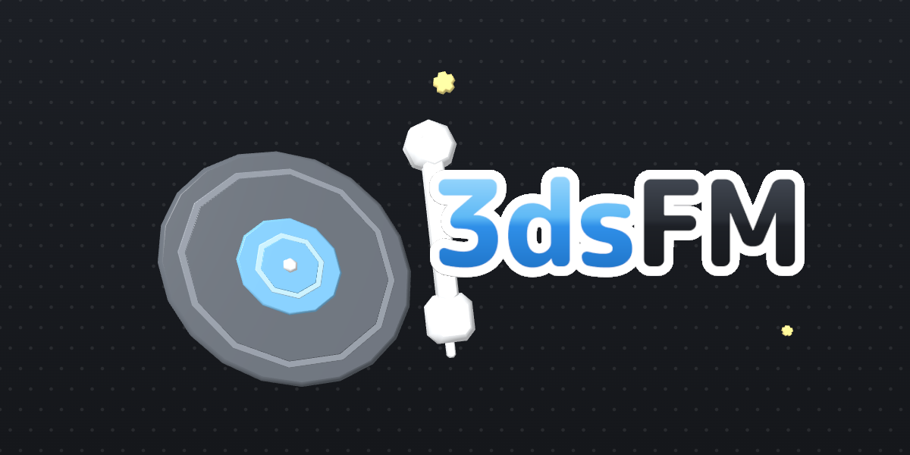
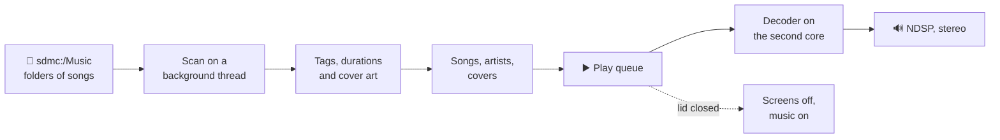

<p align="center">
  
</p>

<p align="center">
  <b>Your music, in stereo, on the Nintendo 3DS.</b><br>
  Copy music to the SD card, close the lid, keep listening.
</p>

<p align="center">
  
  
  
  
</p>

<p align="center">
  <a href="https://ankush.one/3dsFM/"><b>Website</b></a> &nbsp;•&nbsp;
  <a href="#-features">Features</a> &nbsp;•&nbsp;
  <a href="#-install">Install</a> &nbsp;•&nbsp;
  <a href="#-using-3dsfm">Usage</a> &nbsp;•&nbsp;
  <a href="#%EF%B8%8F-building">Build</a> &nbsp;•&nbsp;
  <a href="#-testing">Tests</a> &nbsp;•&nbsp;
  <a href="#%EF%B8%8F-roadmap">Roadmap</a> &nbsp;•&nbsp;
  <a href="#-credits">Credits</a>
</p>

<br>

The 3DS has stereo speakers, a headphone jack, a clamshell that protects the screens in a bag, and a battery that lasts for days when the screens are off. It never had a music player worth using. 3dsFM is one: a Citro2D interface designed to feel like it shipped with the console, a library read from the SD card with tags and cover art, and playback that keeps going when you close the lid.

It shares its toolchain, container build and release pipeline with [3dsDL](https://github.com/ankushKun/3dsDL), the 3DS downloader.

> [!IMPORTANT]
> Version 0.7.0 is a development build. Playback from the SD card works in the Azahar emulator and is being checked on a console; the tag reader, library scanner and play queue are covered by automated tests. It plays music from the SD card only; there is no server, streaming or downloading in the app. The plan is in [docs/PLAN.md](docs/PLAN.md).

## ✨ Features

<table>
  <tr>
    <td width="50%" valign="top">
      <h4>📂 Music from the SD card</h4>
      Drop songs under <code>sdmc:/Music</code>, loose or in folders. Tags come from ID3v1 and ID3v2, Vorbis comments and WAV INFO chunks; untagged files take their artist and title from an <code>Artist - Title</code> file name. The scan is saved as an index on the card: the next launch shows the whole library from it at once and only reads files that are new.
    </td>
    <td width="50%" valign="top">
      <h4>🎧 Four formats</h4>
      MP3, Ogg Vorbis, Opus and WAV, decoded on the second core and mixed by the console's DSP, so the interface never skips while the music plays.
    </td>
  </tr>
  <tr>
    <td valign="top">
      <h4>🖼️ Cover art everywhere</h4>
      Each song's embedded picture, or a <code>cover</code>, <code>folder</code>, <code>front</code> or <code>album</code> image in its folder. Covers on screen load first, and the focused song fogs into the top screen.
    </td>
    <td valign="top">
      <h4>🌙 Lid closed, music on</h4>
      Close the lid and the screens turn off while the song keeps playing, like the console's own sound app. Open it and everything comes back where it was.
    </td>
  </tr>
  <tr>
    <td valign="top">
      <h4>🎚️ Queue, shuffle, repeat</h4>
      An Up next list you can reorder and trim, shuffle and repeat that are remembered between launches, and previous and next on <kbd>L</kbd> and <kbd>R</kbd> from any screen.
    </td>
    <td valign="top">
      <h4>🔍 Search and browse</h4>
      Songs as cover flow, grid or list, artists with their songs, the queue, and a search that matches titles, artists and albums as you type.
    </td>
  </tr>
  <tr>
    <td valign="top">
      <h4>🌊 Visualizer</h4>
      Bars, a waveform, dots or just the art, driven by the samples the DSP is playing, on <kbd>SELECT</kbd>.
    </td>
    <td valign="top">
      <h4>🌗 Two looks</h4>
      A dark theme and a white HOME Menu look, with one selection blue shared by both, drawn with the bundled M PLUS Rounded font so text looks the same on a console and in an emulator.
    </td>
  </tr>
  <tr>
    <td valign="top">
      <h4>🎮 Buttons or touch</h4>
      D-Pad, Circle Pad and buttons everywhere, or tap on the bottom screen: one tap selects, a second opens. Lists drag and flick.
    </td>
    <td valign="top">
      <h4>🧪 Tested off the console</h4>
      The tag reader, library scanner, play queue and time formatting run as host tests under AddressSanitizer and UBSan on every push.
    </td>
  </tr>
</table>

## 🔄 How it works



## 📦 Install

**You'll need**

- A Nintendo 3DS that can run homebrew
- The console's DSP firmware dumped once with [DSP1](https://github.com/zoogie/DSP1) to `sdmc:/3ds/dspfirm.cdc` (most homebrew setups already have it)
- `3dsFM.3dsx` or `3dsFM.cia` from the [releases page](https://github.com/ankushKun/3dsFM/releases), or your own build (see [Building](#%EF%B8%8F-building))

The [website](https://ankush.one/3dsFM/) has QR codes that install the latest release straight from FBI.

**Homebrew Launcher (.3dsx)**

Copy the executable to this path on the SD card and launch **3dsFM** from the Homebrew Launcher:

```text
sdmc:/3ds/3dsFM/3dsFM.3dsx
```

**HOME Menu (.cia)**

Install `3dsFM.cia` with FBI to launch it from the HOME Menu, with the animated 3D banner and jingle. The CIA uses the stable Title ID `0004000003D5F100`, so newer builds upgrade the installed title instead of adding a duplicate.

## 🎵 Using 3dsFM

Copy music to the SD card as folders, one album per folder, with the artist as the folder above it if you like:

```text
sdmc:/Music/Miki Matsubara/Pocket Park/01 - Mayonaka no Door.mp3
sdmc:/Music/Miki Matsubara/Pocket Park/cover.jpg
```

You can also drop songs straight into the Music folder with no folders at all. The library then works out the rest:

- Title, artist, album, album artist, year, track number and cover come from the file's own tags: ID3v2 and ID3v1 in MP3s, Vorbis comments in Ogg and Opus, the INFO chunk in WAVs.
- When a tag is missing, a file named `Artist - Title.mp3` fills it in; otherwise the file name is the title. Inside folders, the folder is the album and the folder above it the artist.
- Video-site noise such as `(Official Video)`, `[Lyrics]`, `[HD]` or a trailing video id is taken off titles.
- Artists are gathered from the songs' own artist tags, so a flat folder of downloads still gives a proper artist list with a song count each.
- `._name` resource forks, `.DS_Store` and `Thumbs.db` files that a computer leaves next to the music are deleted during the scan.

The first launch reads every file, which takes a while for a big library; after that the library appears at once from the index on the card and new files are picked up in the background. After editing tags, pick **Rescan the Music folder** in Settings.

1. The bottom screen opens on **Songs**. The three tabs top left are **Songs**, **Artists** and **Queue**; the round buttons top right open **Search**, **Now Playing** and **Settings**.
2. Songs has three views, switched with <kbd>X</kbd> or the small button next to the tabs and remembered between launches: cover flow, where the focused cover sits large in the middle and a flick glides through the rest; a grid of covers; and a list.
3. Artists lists everyone with their song count; open one for their songs with play and shuffle buttons.
4. Pick a song. The top screen shows what is playing, with the art fogged behind it. <kbd>Y</kbd> on any song plays it now, adds it to the queue or jumps to its artist.
5. Close the lid. The music keeps playing until the queue ends or you open it again, and the app stops drawing while the screens are dark.

### Controls

| Where | Input | What it does |
| --- | --- | --- |
| Everywhere | D-Pad, Circle Pad or touch | Move the focus, or tap once to select and again to open |
| Everywhere | Up from the top of a list | Move the cursor into the top row: the tabs, Search, Now Playing and Settings. Left and Right move along it, A opens, Down or B comes back |
| Everywhere | <kbd>A</kbd> / <kbd>B</kbd> | Open, play or pause / go back |
| Everywhere | <kbd>L</kbd> / <kbd>R</kbd> | Previous and next song |
| Everywhere | <kbd>START</kbd> | Play or pause; with <kbd>SELECT</kbd> held, quit |
| Everywhere | <kbd>SELECT</kbd> | Visualizer |
| Songs | <kbd>X</kbd> | Switch between cover flow, grid and list |
| Songs | <kbd>Y</kbd> | Menu: play now, add to the queue, go to the artist |
| Artists | <kbd>Y</kbd> | Shuffle the artist |
| Queue | <kbd>X</kbd> | Remove the song from the queue |
| Lists | Drag or flick | Scroll |
| Cover flow | Drag or flick | Glide through the covers; tap a neighbour to bring it to the front, tap the middle to play |
| Now Playing | Up / Down | Move the cursor between the buttons and the Up next list |
| Now Playing | Touch the bar | Seek |

### Settings

| Setting | Default | What it does |
| --- | --- | --- |
| Keep playing with the lid closed | On | Closing the lid turns the screens off and keeps the music going. Off pauses, like other homebrew. |
| Decode on the second core | Off | Runs the audio decoder on the console's second core so the screens never hitch. Takes effect from the next song. |
| Dark mode | On | Dark screens with light text. Off gives the white HOME Menu look. |
| Full-screen album art | On | Fills the top screen with the focused album's art. Off keeps the art in a small sleeve, which saves some battery on an Old 3DS. |
| Music folder | `sdmc:/Music` | Where 3dsFM looks for music. Typed with the console keyboard. |
| Rescan the Music folder | | New files are picked up every launch; this reads every file's tags again, for when you have edited them. |

Shuffle, repeat and the visualizer style are set from Now Playing and remembered too.

### Files on the SD card

| Path | Contents |
| --- | --- |
| `sdmc:/Music/` | Your music, loose or in folders (the folder is a setting). |
| `sdmc:/3ds/3dsFM/settings.ini` | Settings, including shuffle, repeat and the visualizer style. |
| `sdmc:/3ds/3dsFM/library.idx` | The library index: every song's tags and cover file from the last scan. The next launch builds the library from it before reading any music file. Delete it to force a full scan. |
| `sdmc:/3ds/3dsFM/log.txt` | A log of launches, scans, HOME Menu hand-overs and playback. It is kept across launches so a freeze leaves its last lines behind, and starts over past 256 KB. Attach it when reporting a bug. |
| `sdmc:/3ds/dspfirm.cdc` | The DSP firmware NDSP needs. Without it 3dsFM runs silently and says so. |

## 🛠️ Building

The recommended way is the reproducible container build. All it needs is Docker Desktop, or the Docker CLI with Colima on macOS:

```sh
git clone https://github.com/ankushKun/3dsFM.git
cd 3dsFM
./scripts/build.sh
```

When it finishes, everything you need is in `dist/`:

```text
dist/
├── 3dsFM.3dsx     Homebrew Launcher build
├── 3dsFM.cia      HOME Menu install
├── 3dsFM.smdh     icon and title metadata
└── 3dsFM.sha256   checksums for all of the above
```

<details>
<summary><b>What the build script does</b></summary>

<br>

1. Checks that Docker is available and starts Colima if it needs to.
2. Pulls the digest-pinned `devkitpro/devkitarm:20260610` image and builds the checksum-verified CIA tools image if it isn't cached yet.
3. Makes sure the launcher icon PNG has a real alpha channel.
4. Cleans out previous build output.
5. Compiles 3dsFM with the bundled fonts in romfs, running the containers as your user so nothing in the repository ends up owned by root.
6. Packs the HOME Menu banner, its jingle and the icon (see [`resources/banner/`](resources/banner/README.md)) and packages both the 3DSX and CIA builds, taking the version from the `VERSION` file.
7. Writes the release files and their SHA-256 checksums to `dist/`.
8. Removes intermediate files so the repository root stays clean.

</details>

<details>
<summary><b>Build options</b></summary>

<br>

```sh
# Only the 3DSX, for quick emulator runs
THREEDSFM_3DSX_ONLY=1 ./scripts/build.sh

# Use more compiler jobs
THREEDSFM_BUILD_JOBS=4 ./scripts/build.sh

# Pack the flat banner picture instead of the 3D model
THREEDSFM_FLAT_BANNER=1 ./scripts/build.sh

# Pack another CGFX, such as a still of the model (see resources/banner/README.md)
THREEDSFM_BANNER_CGFX=build/3dsFM-still.cgfx ./scripts/build.sh

# Use another devkitPro image (the default is pinned by digest)
THREEDSFM_BUILD_IMAGE=devkitpro/devkitarm:20260610 ./scripts/build.sh

# Use another CIA packaging image
THREEDSFM_CIA_IMAGE=3dsfm-cia-tools:1.0.0 ./scripts/build.sh
```

</details>

<details>
<summary><b>Running in the emulator</b></summary>

<br>

```sh
./scripts/install-emulator.sh       # one-time: a pinned Azahar into ~/Applications
./scripts/run.sh --build            # build the 3DSX, then open it in Azahar
./scripts/make-test-music.sh "$HOME/Library/Application Support/Azahar/sdmc/Music"
                                    # a fake library of tones in every format (needs ffmpeg)
```

Azahar emulates the DSP at a high level, so any file of a few kilobytes at `sdmc/3ds/dspfirm.cdc` inside its SD card folder gives it sound. It lacks the console's shared font and substitutes a wide one, which is why 3dsFM ships its own.

For crash testing, a file at `sdmc:/3ds/3dsFM/smoke.txt` with space-separated key names (`A B X Y L R UP DOWN LEFT RIGHT START SELECT WAIT`) is played back one key every 20 frames and logged to `log.txt`. Empty files named `debug-noart`, `debug-notext`, `debug-nodots`, `debug-sysfont` or `debug-c2dcircles` in the same folder switch those parts off for A/B testing.

Two emulator notes learned the hard way: Azahar's screenshot action produces a black image for this homebrew, and typing into its window can trip hotkeys (a `-` lowers the speed limit by 5%). If the status bar shows a speed below 100%, reset `frame_limit` in its config.

</details>

<details>
<summary><b>Other scripts</b></summary>

<br>

```sh
./scripts/make-banner.sh            # rebuild the 3D HOME Menu banner from resources/banner/
./resources/banner/render.sh        # re-render the icon, flat banner and website art from the model
./scripts/make-fonts.sh             # regenerate romfs/fonts from the TTFs
./scripts/make-site-qr.sh           # regenerate the website's install QR codes
```

</details>

<details>
<summary><b>Building without Docker</b></summary>

<br>

Install devkitARM, libctru, Citro2D, Citro3D, 3ds-mpg123, 3ds-libopus, 3ds-opusfile, 3ds-libvorbisidec, 3ds-libogg, 3ds-libjpeg-turbo, 3ds-libpng and 3ds-zlib through devkitPro's pacman, then run `make` in the repository root.

</details>

<details>
<summary><b>Reproducibility and releases</b></summary>

<br>

Building the same commit twice gives a byte-identical `3dsFM.3dsx`. The CIA is identical too, except for the ticket ID, title key and content ID that makerom randomises on every run; the packaged app inside it does not change.

GitHub Actions runs the tests and the container build on every push and pull request and keeps `dist/` as a build artifact. To release, bump `VERSION`, commit, and push a matching tag such as `v0.7.0`. The workflow checks that the tag matches, verifies the checksums and publishes the release, which the website's QR codes point at through `releases/latest/download/`.

</details>

## 🧪 Testing

Everything that doesn't need console hardware builds and runs on a normal computer: the tag reader (ID3v1, ID3v2.3 and 2.4 with pictures, Vorbis and Opus comments with embedded art, WAV INFO, durations), the library scanner (albums, artists, playlists, cover files, search), the play queue (shuffle, repeat, removal) and time formatting. The tests run under AddressSanitizer and UBSan.

```sh
make -C tests check
```

You need a C++17 compiler and Python 3. Thirty tests run from [`tests/unit/`](tests/unit/) against fixtures the tests write themselves.

The parts that need a console (NDSP, the DSP firmware, lid detection, backlights, the HOME Menu banner) are checked by hand on hardware before a release.

<details>
<summary><b>Project layout</b></summary>

<br>

```text
source/app/      console-only code: screens (app.cpp), UI primitives (ui.cpp), art
                 textures (art.cpp), decoders and the NDSP player, platform services
source/core/     portable logic with no 3DS headers: tag reader, library scanner,
                 play queue, time formatting
tests/           host-side unit tests for source/core
scripts/         container build, emulator install and launch, banner, fonts, test music
resources/       launcher icon, HOME Menu banner and jingle, CIA rsf, font sources
romfs/fonts/     M PLUS Rounded 1c as BCFNT (SIL OFL), see romfs/fonts/LICENSE.md
docs/            design system and the build plan
site/            the website, published by GitHub Pages (see site/README.md)
```

Anything that can run without a console lives in `source/core` and has a test. Anything that touches libctru lives in `source/app`. The UI runs on the main thread, audio decoding on the second core when the system allows it, and album art decoding and the library scan on threads two priority steps below the UI, under libctru's own APT handler thread, so they only use the time the UI spends waiting for vsync and never hold up the HOME button. All of them go idle while the console is in the HOME Menu or asleep.

</details>

## 🗺️ Roadmap

Version **0.2** brought the animated 3D HOME Menu banner and the matching icon. Next up:

- [ ] Hardware pass on a New 3DS: lid-closed playback, the banner, battery with the screens off
- [ ] Lyrics, with `.lrc` sidecar files for local music
- [ ] Kanji in the bundled fonts

The full plan and the decisions behind it live in [docs/PLAN.md](docs/PLAN.md); the design system is in [docs/DESIGN.md](docs/DESIGN.md). Bug reports and focused pull requests are very welcome over in [Issues](https://github.com/ankushKun/3dsFM/issues).

## 💙 Credits

3dsFM stands on the shoulders of these projects:

- [**mpg123**](https://www.mpg123.de/), [**Tremor**](https://gitlab.xiph.org/xiph/tremor), [**libopus** and **opusfile**](https://opus-codec.org/) and [**libogg**](https://xiph.org/ogg/), for decoding MP3, Ogg Vorbis and Opus
- [**libjpeg-turbo**](https://libjpeg-turbo.org/), [**libpng**](http://www.libpng.org/pub/png/libpng.html) and [**zlib**](https://zlib.net/), for cover art
- [**M PLUS Rounded 1c**](https://github.com/coz-m/MPLUS_FONTS) by The M+ FONTS Project, the interface font (SIL OFL, see [romfs/fonts/LICENSE.md](romfs/fonts/LICENSE.md))
- [**pycgfx**](https://github.com/skyfloogle/pycgfx) by skyfloogle and the banner notes in [**CBC for YANBF**](https://github.com/daaaaavia/CBC-for-YANBF), for the 3D HOME Menu banner
- [**QR Code generator**](https://www.nayuki.io/page/qr-code-generator-library) by Project Nayuki (MIT), used to draw the website's install codes
- [**devkitPro**](https://devkitpro.org/), **libctru**, **Citro2D** and **Citro3D**, which make 3DS homebrew possible at all

## 📄 License

3dsFM is released under the [GNU General Public License v3.0](LICENSE). Bundled third-party components keep their own notices.

<br>

<p align="center">
  <br>
  Made by <a href="https://ankush.one">ankushKun</a> &nbsp;•&nbsp; <a href="https://github.com/ankushKun">GitHub</a> &nbsp;•&nbsp; <a href="https://x.com/ankushKun_">X</a>
</p>
